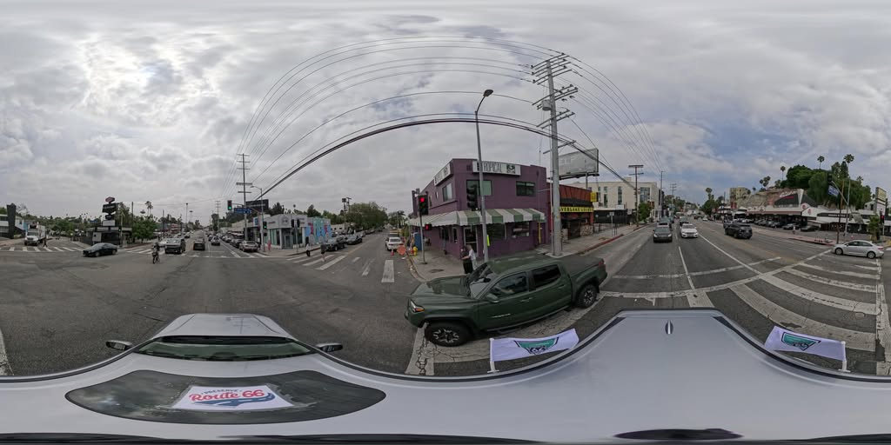
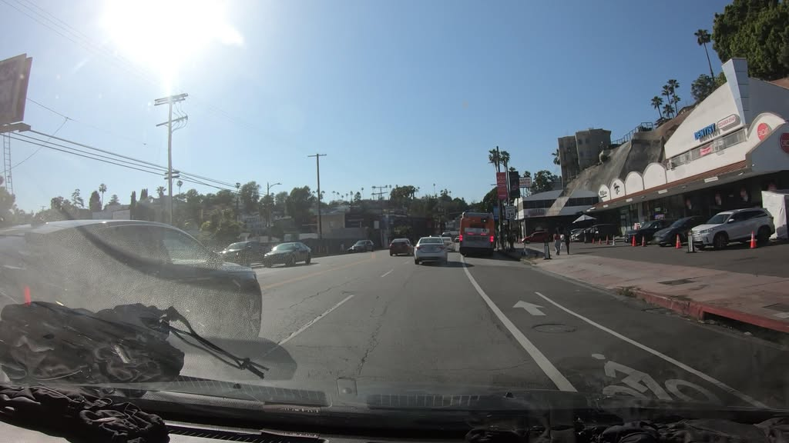
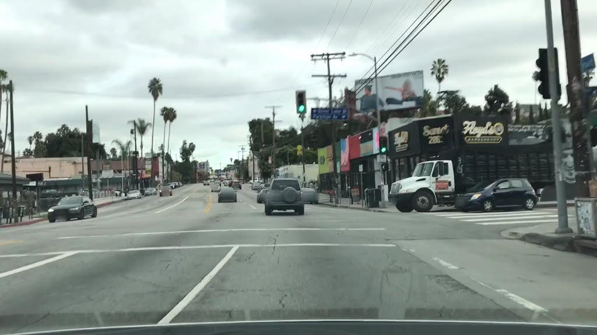
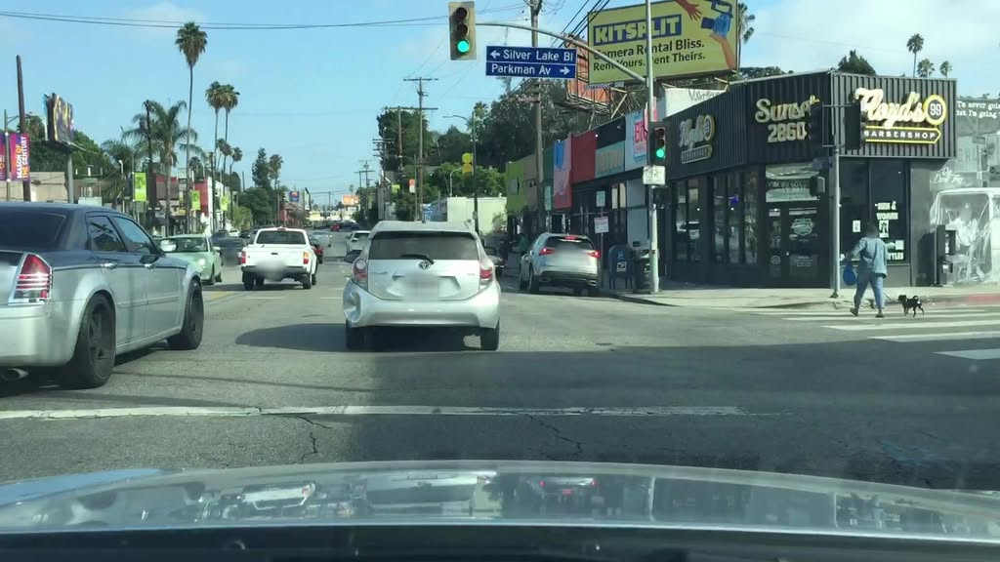
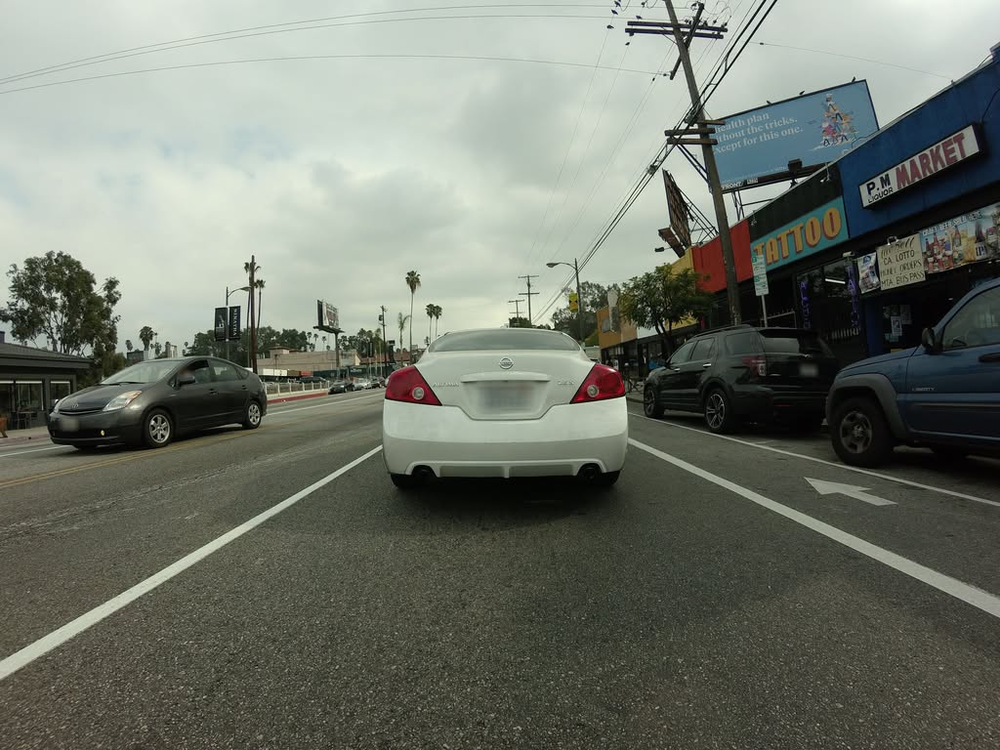
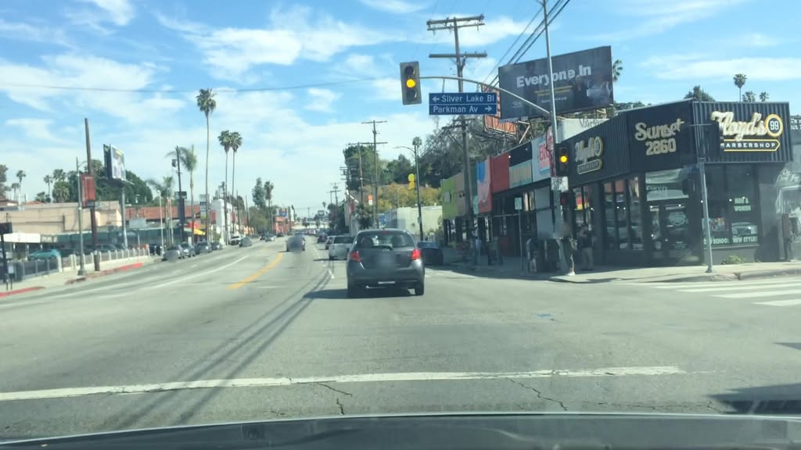
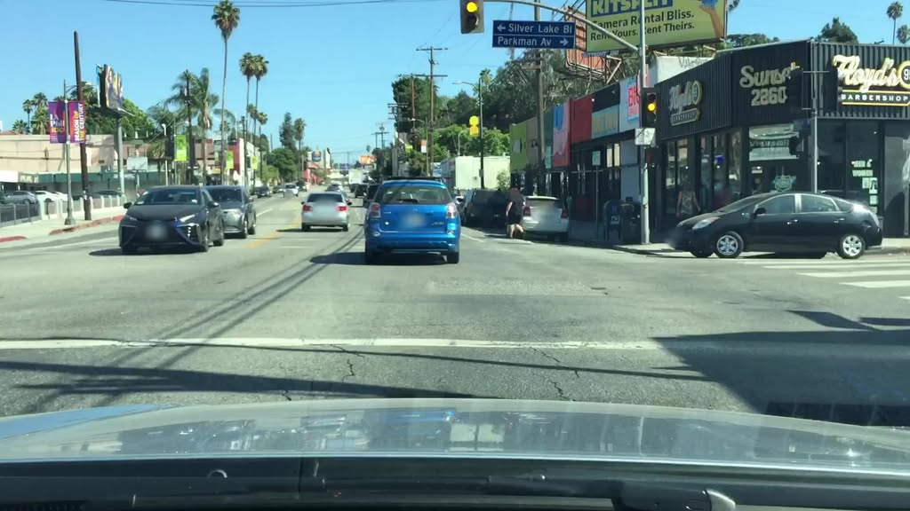
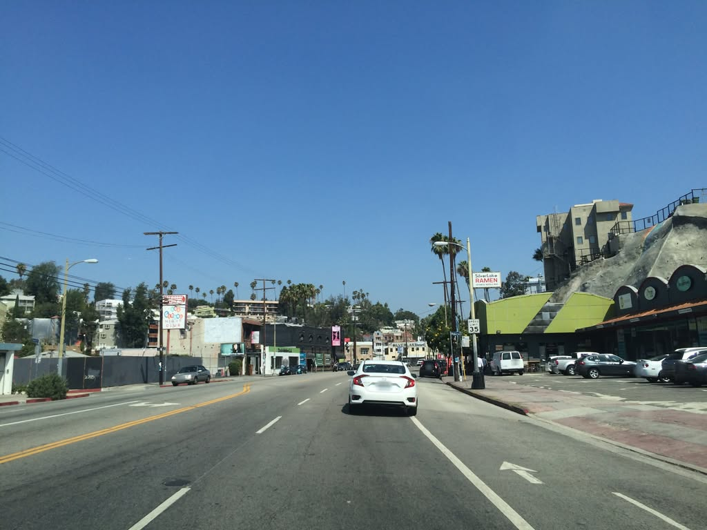
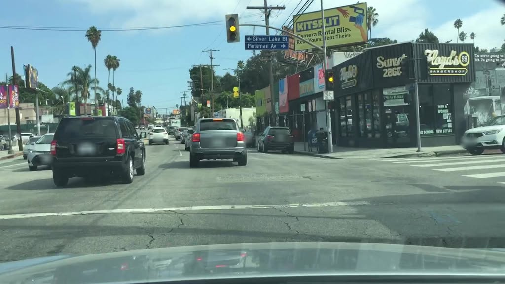
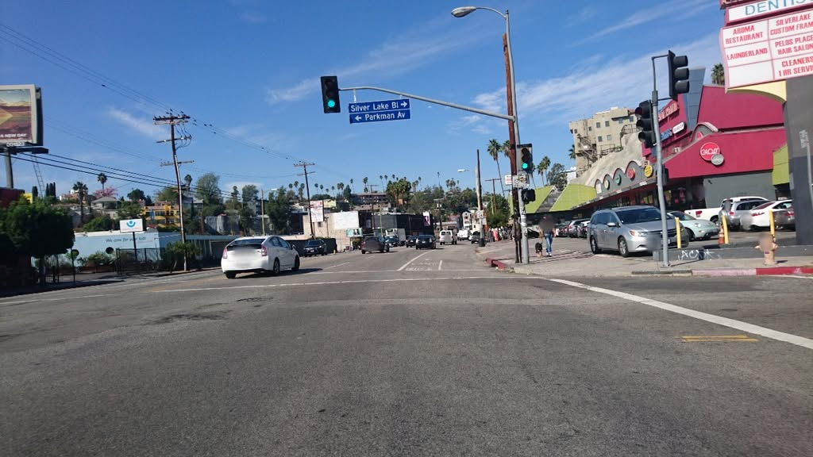

# Example photos — Cafe Tropical, Sunset & Silver Lake

Up to 10 sample street-level images from each service near **Cafe Tropical** (2900 W Sunset Blvd,
34.08290, -118.27355). Generated 2026-11-27 by `scripts/make_photo_examples.py`. Click an image to open it in the service's viewer.
See [photos.md](photos.md) for the comparison.

| Service | Shown | Pool | Image hosting in this doc |
|---|---|---|---|
| Mapillary | 10 | 496 images in the near-cafe box | thumbnails copied into the repo (signed URLs expire) |
| KartaView | 10 | 429 photos within ~300 m | hotlinked from `cdn.kartaview.org` |
| Panoramax | 1 | 1 image(s) in all of Silver Lake (none in the focus box) | hotlinked from the source instance |

Picks: one image per sequence where possible, spread across capture years, nearest to the cafe first.

## Mapillary
<table>
<tr><td align="center" width="50%"> 2026-06-06 · 12 m from cafe · heading 136°</td><td align="center" width="50%"> 2023-06-20 · 21 m from cafe · heading 315°</td></tr>
<tr><td align="center" width="50%"> 2019-01-07 · 8 m from cafe · heading 137°</td><td align="center" width="50%"> 2018-09-04 · 7 m from cafe · heading 138°</td></tr>
<tr><td align="center" width="50%"> 2016-01-30 · 15 m from cafe · heading 279°</td><td align="center" width="50%"> 2019-03-26 · 11 m from cafe · heading 136°</td></tr>
<tr><td align="center" width="50%"> 2018-09-06 · 9 m from cafe · heading 139°</td><td align="center" width="50%"> 2016-08-04 · 23 m from cafe · heading 309°</td></tr>
<tr><td align="center" width="50%"> 2018-09-05 · 10 m from cafe · heading 136°</td><td align="center" width="50%"> 2016-11-04 · 31 m from cafe · heading 326°</td></tr>
</table>

Images © Mapillary contributors, CC-BY-SA 4.0.

## KartaView
<table>
<tr><td align="center" width="50%"> 2019-03-12 · 20 m from cafe · heading 232°</td><td align="center" width="50%"> 2019-03-01 · 23 m from cafe · heading 261°</td></tr>
<tr><td align="center" width="50%"> 2019-03-01 · 29 m from cafe · heading 127°</td><td align="center" width="50%"> 2019-04-19 · 108 m from cafe · heading 159°</td></tr>
<tr><td align="center" width="50%"> 2019-03-12 · 20 m from cafe · heading 220°</td><td align="center" width="50%"> 2019-03-01 · 82 m from cafe · heading 230°</td></tr>
<tr><td align="center" width="50%"> 2019-04-19 · 114 m from cafe · heading 169°</td><td align="center" width="50%"> 2019-03-12 · 151 m from cafe · heading 243°</td></tr>
<tr><td align="center" width="50%"> 2019-04-19 · 186 m from cafe · heading 157°</td><td align="center" width="50%"> 2019-03-12 · 220 m from cafe · heading 102°</td></tr>
</table>

Images © KartaView contributors, CC-BY-SA 4.0. KartaView's API reports only the upload date for most of these.

## Panoramax
<table>
<tr><td align="center" width="50%"> 2024-01-24 · 893 m from cafe · heading 168°</td></tr>
</table>

License per image: CC-BY-SA-4.0.
